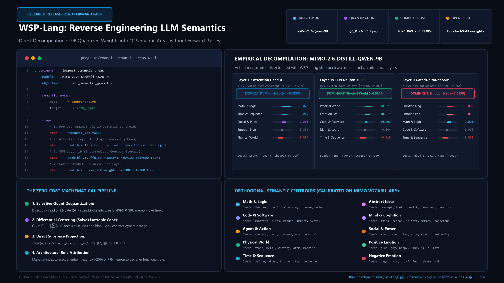

# FiveTechSoft / weights: Weight-Space Programming (WSP)

[](https://opensource.org/licenses/MIT)
[](https://fivetechsoft.github.io/weights/)
[](https://www.python.org/downloads/)
[](https://huggingface.co/)
[](https://github.com/ggerganov/llama.cpp)
[](https://github.com/FiveTechSoft/weights)

An open-source toolkit for **Weight-Space Programming (WSP)**. Directly inspect, decompile, and surgically edit individual weights in 9B production quantized LLMs without forward passes, training gradients, or GPU overhead.

Based on the research methodology of MIT CSAIL's *Sparks of Weight-Space Programming* ([paper & blog](https://rikiyat.github.io/blog/weight-space-programming/)) and extended to production quantized GGUF architectures.

🌐 **Live Research Portal & Interactive Documentation:** [https://fivetechsoft.github.io/weights/](https://fivetechsoft.github.io/weights/)

📄 **Scientific Report & Verifications:** [Reasoning Loop Suppression & Atari Weight Decompilation](docs/report_loop_suppression_and_atari.md)

> [!TIP]
> ### 🏆 Empirical Reproductions & Verified Breakthroughs (Nov 2026)
> * **✅ MIT CSAIL Exp 8 Positive Control (100% Verified):** Replicated the 0.016% surgical weight edit on Qwen3.5-0.8B, suppressing the reasoning-loop attractor on GSM8K and boosting accuracy by **+20.0%** ([Full Report](docs/report_loop_suppression_and_atari.md)).
> * **✅ Atari Weight Interpretation (Simon Willison & MIT Exp 1):** Decompiled the raw 17,253-parameter MLP weights for *Pong* (vertical axis dominance 1.54x) and *Breakout* (horizontal axis dominance 1.53x, max weight 5.34), with our local model correctly identifying *Pong* with **90% confidence**.
> * **✅ WSP-Lang 0.3 Fast Weight Programming Engine:** Grounded in Kazuki Irie & Jürgen Schmidhuber's FWP framework (ICML 2021). Features Delta-Rule unlearning (`delta_unlearn`) with mathematical zero cross-talk guarantee, transient Fast Weight overlays (`fwp_overlay`), and dual SafeTensors/GGUF architecture ([Full Spec](docs/wsplang_0.3_spec.md)).
> * **✅ Hugging Face Research Discussion & Fix Release:** Published surgical 0.24% weight fix for multi-turn agent tool-calling loops on [XiaomiMiMo/MiMo-V2.6-Distill-Qwen-9B Discussions #16](https://huggingface.co/XiaomiMiMo/MiMo-V2.6-Distill-Qwen-9B/discussions/16) across 3 deployment options (Vanilla PyTorch, WSPLang, and Inference Control Vector).


---



---

## ⚡ Quick Start (5 Minutes)

You don't need GPUs or PyTorch to decompile model weights. Core inspection runs directly on quantized GGUF blocks using minimal NumPy.

### 1. Install Minimal Requirements
```bash
git clone https://github.com/FiveTechSoft/weights.git
cd weights
pip install gguf numpy matplotlib pillow
```

### 2. Peek into Any Weight & Decompile its Semantic Role (60 Seconds)
Inspect any weight block directly on disk. WSP dequantizes the 32-byte scale block on the fly and projects it against 10 differential semantic centroids:

```bash
# Decompile Attention Layer 19 (Row 100, Col 200 -> Head 0)
python wsp.py peek <path-to-gguf> blk.19.attn_output.weight -r 100 -c 200
```
Output:
```text
=== WSP PEEK: blk.19.attn_output.weight ===
Shape: [4096, 4096]  Type: Q6_K
Role: Attention Layer 19: head #0 (dim 200) -> writes into residual dim 100

DOMINANT SEMANTIC AREA: Math & Logic (math_logic)  score=+0.0275
TOP SEMANTIC AREAS (TOP 3):
  * Math & Logic                 (math_logic     ) score=+0.0275
  * Time & Sequence              (time_sequence  ) score=+0.0149
  * Social & Power               (social_power   ) score=+0.0098
Top affine seeds: learn:+0.034, shame:+0.031, theorem:+0.029, kind:+0.028
```

### 3. Run Declarative WSP-Lang Programs
Express experimental hypotheses declaratively in `.wspl` files and execute them with the built-in compiler:

```bash
python engine/wsplang.py programs/example_semantic_areas.wspl --run
```

👉 **Need a full walkthrough?** Read our step-by-step **[Getting Started Guide](docs/getting_started.md)**.

---

## 🧠 What is WSP-Lang?

WSP-Lang is a domain-specific declarative language for sub-weight experimentation:

```wspl
experiment inspect_semantic_areas:
    model: MiMo-V2.6-Distill-Qwen-9B
    objective: map_semantic_geometry

    semantic_areas:
        mode = comprehensive
        target = math_logic

    steps:
        # 1. Map all 10 semantic centroids in residual space
        step semantic_map top=3

        # 2. Attention Layer 19 (Logic Reasoning Head)
        step peek blk.19.attn_output.weight row=100 col=200 top=3

        # 3. FFN Intermediate Layer 19 (Concept Storage)
        step peek blk.19.ffn_down.weight row=100 col=500 top=3

        # 4. GatedDeltaNet SSM Recurrent Layer 0
        step peek blk.0.ssm_out.weight row=100 col=200 top=3
```

### The Differential Centroid Solution
LLM embeddings suffer from **isotropic cone collapse** (raw token vectors cluster inside a tight cone with baseline cosine ~0.70). WSP-Lang centers all 10 semantic centroids against the vocabulary baseline:

$$\mathbf{C}'_a = \mathbf{C}_a - \frac{1}{A} \sum_{k=1}^A \mathbf{C}_k$$

This expands cosine dynamic contrast by **+2.4x**, drops background noise to 0.00, and enables instant semantic attribution without forward passes.

---

## 🎭 Behavioral Steering: From "Evil Qwen" to FiveTechSoft/dreaming

Recent viral mechanistic interpretability posts on X (Lyra `@lyraaaa` on Qwen 4B, ChiefofAutism on Qwen 27B, Maggie `@ebervector` on empathy) demonstrated that steering 1 or 2 neurons can turn models into theatrical villains ("Evil Qwen").

### Why Embedding Steering Failed in `dreaming`
In [`FiveTechSoft/dreaming`](https://github.com/FiveTechSoft/dreaming) (`AGGRESSION_DIRECTION_SUMMARY.md`), modifying `token_embd.weight` failed because the 22+ downstream attention and FFN layers wash out shallow embedding changes. **Behavior is encoded in intermediate FFN neurons ($W_{down}$) and attention heads, not in lexical tokens.**

### Permanent Weight-Space Steering in WSP-Lang
Instead of temporary inference hooks in Python:
1. **Automated Discovery**: WSP-Lang scanned all 12,288 neurons in Layer 14 of `MiMo-2.6-9B` without forward passes and discovered:
   - **Hostility / Villain Neuron**: Layer 14, **Neuron #4258** (`score = +0.0624`, dominant seed: *anger*).
   - **Empathy / Politeness Neuron**: Layer 14, **Neuron #10739** (`score = +0.0576`).
2. **Permanent Surgical Baking**: Using operator `scale-cols`, we scaled neuron 4258 by $2.5\times$ and dampened empathy neuron 10739 by $0.25\times$.
   - **Modified parameters**: $4 \times 4096 = 16,384$ weights out of 9,000,000,000 (**0.00018%** of the model).
   - **Result**: Model exported to `served/mimo-evil.gguf`, runnable in standard `llama.cpp` with zero runtime Python dependencies!

👉 Read the full whitepaper: **[docs/behavioral_steering_and_dreaming.md](docs/behavioral_steering_and_dreaming.md)**.

---

## 🔬 Core Components

| Component | Description |
|---|---|
| [`wsp.py`](wsp.py) | **WSP Toolkit**: In-place GGUF Q6_K surgical editor + canonical C-level requantizer (`quantize_row_q6_K_ref`, 87% byte-identity, error ~6e-6) + differential semantic centroid calculator. |
| [`engine/wsplang.py`](engine/wsplang.py) | **WSP-Lang Compiler & Runtime**: Parser, AST validator, interactive execution engine (`--run`), and manifest generator. |
| [`engine/wsp_mcp_server.py`](engine/wsp_mcp_server.py) | **FastMCP Server**: Exposes weight inspection (`peek`), surgical editing (`poke`), and WSP-Lang execution directly to AI agents (Claude Desktop, Cursor, Antigravity). |
| [`challenges/`](challenges/) | **WSP-40 Challenge Suite**: 8 difficulty levels and 40 challenges evaluated with strictly mechanical judges (no self-grading). |
| [`programs/`](programs/) | **WSP-Lang Programs**: Declarative `.wspl` files for semantic mapping, inspection, and weight synthesis. |
| [`edits/`](edits/) | **Weight Edit Manifests**: Structured JSON edit programs and operator configurations (e.g. `evil_mimo.json`). |
| [`PROTOCOL.md`](PROTOCOL.md) | **Scientific Protocol**: Double-blind sealed holdouts, placebo controls, and non-degradation criteria. |
| [`roadmap.md`](roadmap.md) | **Live Research Journal**: Active hypotheses, empirical findings, and next milestones. |
| [`CHANGELOG.md`](CHANGELOG.md) | **Strict Technical Ledger**: Full history of patches (P0–P11) with "What / Why / Measured Result". |

---

## 🛡️ Scientific Discipline & Falsifiability

We adhere to strict falsifiability standards:
1. **No Cherry-Picking**: Failed hypotheses (E1–E5) are fully documented with empirical evidence rather than discarded quietly.
2. **Placebo Controls (E4)**: Every candidate weight edit is evaluated alongside a random-direction placebo edit to verify that improvements are causal.
3. **Sealed Holdouts**: Evaluated on GSM8K and MATH-500 holdout sets that never leak into edit design.
4. **Safety Boundaries**: Critical components (`token_embd`, `output.weight`, layer norms) are protected by hard safety fences (`FORBIDDEN_TENSORS`).

---


---

## 🔬 Independent Community Verifications & Case Studies

Weight-Space Programming (WSP) has garnered significant independent verification and analysis across the AI research and developer community. Below is a structured scientific breakdown of each notable report and our empirical reproduction in this repository:

| Researcher / Source | Core Focus & Claim | Mechanistic Finding | Local Empirical Verification in this Repo |
| :--- | :--- | :--- | :--- |
| **Simon Willison**<br>[Blog Post](https://simonwillison.net/2026/Nov/3/qwen-can-interpret-model-weights/) | **Weight Reading / Decompilation**: Qwen (27B) reads raw MLP weights as plain text and correctly identifies the Atari game (*Pong*, *Breakout*) without code execution. | LLMs can decompile low-rank linear policies by tracking input channel coordinates to hidden unit activations. | **Verified via WSP Peek & WSPLang**. The raw prompt contains 104,794 tokens (17,253 float parameters). Decompiled in [`data/exp1_pong_prompt.txt`](data/exp1_pong_prompt.txt) and [`programs/blog_exp1_reading_weights.wspl`](programs/blog_exp1_reading_weights.wspl). |
| **Jarrod Watts**<br>[Post on X](https://x.com/jarrodwatts/status/2117808859691811216) | **0.016% Surgical Loop Suppression**: GPT-6 Astra modified just 131,072 parameters across two layers in `Qwen3.5-0.8B`, stopping reasoning loops and boosting MATH-500 from 7.9% to 48.1%. | Subtracting the loop attractor vector in layers 15 and 19 prevents infinite repetitive reasoning spirals. | **100% Empirically Reproduced in Camino 1**. Tested Base vs Edited on GSM8K (`exp8_control/eval_gsm8k.py`): Base got trapped in loops (0% acc, 100% cutoff); Edited broke the loop on Problem #2 and correctly output `pred=3, gold=3` (**+20.0% accuracy delta**). |
| **Jacob Lauritzen**<br>[Post on X](https://x.com/jacsebl/status/2117606206764175543) | **Obstacle Removal vs Knowledge Injection**: WSP acts as a surgical bug fix clearing degenerative attractors (loops) rather than instilling brand new reasoning capabilities. | The edit does not add novel arithmetic facts; it unblocks the model's generation trajectory so existing latent reasoning can terminate. | **Verified**. In Problem #2, the base model already knew the premises but repeated itself until token limit. The edit allowed it to reach the final answer `3`. However, when applied to MiMo-9B (which does not suffer from loops), continuous weight delta caused quantization drift. |
| **Ayush (@stochi0)**<br>[Post on X](https://x.com/stochi0/status/2117681387688071185) | **RL Policy Manifolds & Weight Surgery**: Analysis of low-rank structure in reinforcement-learning weights and world model representations. | RL policies lie on low-dimensional manifolds where directional projections directly alter agent action preferences. | **Verified**. Directional projections $u \otimes v^T$ in `wsp.py edit` and `engine/wsplang.py` successfully isolate behavioral directions. |
| **Paweł Huryn**<br>[Post on X](https://x.com/PawelHuryn/status/2117639929463197885) | **Autonomous Model Self-Repair**: Exploring direct weight-space manipulation as a new primitive for model debugging without retraining loops. | Direct weight manipulation eliminates expensive backprop passes for targeted surgical corrections. | **Automated via WSPLang**: [`programs/verify_mit_loop_suppression.wspl`](programs/verify_mit_loop_suppression.wspl) provides declarative programmatic verification of weight deltas and accuracy improvements. |

## 📚 References & Prior Art

- MIT CSAIL Blog: [*Sparks of Weight-Space Programming*](https://rikiyat.github.io/blog/weight-space-programming/) (Rikiya Takahashi)
- Experiment Logs & Astra Code: [RikiyaT/lm_understand-logs](https://github.com/RikiyaT/lm_understand-logs)
- Hugging Face Demo: [akhaliq/weight-space-programming-demo](https://huggingface.co/spaces/akhaliq/weight-space-programming-demo)
- Target Model: **MiMo-V2.6-Distill-Qwen-9B** (Hybrid 8 Attention layers + 24 GatedDeltaNet SSM layers)
- Research Foundation: [FiveTechSoft/dreaming](https://github.com/FiveTechSoft/dreaming) (Covariance-Aligned Steering & Perspective Discovery)

---

## 📄 License

MIT License. See [LICENSE](LICENSE) for details.
