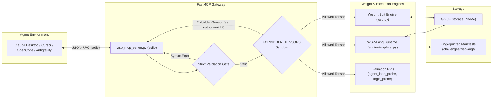

# WSP FastMCP Server Reference Guide

**Server Name:** `wsp-challenge`  
**Transport:** Standard Input/Output (`stdio`)  
**Specification:** Model Context Protocol (MCP) Protocol Version `2024-11-05`  
**Implementation:** FastMCP Python 3 (`engine/wsp_mcp_server.py`)  
**Repository:** [github.com/FiveTechSoft/weights](https://github.com/FiveTechSoft/weights)  

---

## 1. Overview & Architecture

The **WSP FastMCP Server** acts as an intelligent, secure laboratory bridge between autonomous AI agents (such as Claude Desktop, OpenCode, Cursor, or Antigravity) and quantized local model weights (GGUF `Q6_K` / `BF16`):



### Key Capabilities
1. **Introspection without a forward pass:** Read individual weights, their architectural role and their projection on semantic centroids (a lexical heuristic, not a measured function).
2. **In-Memory Code Execution:** Execute arbitrary WSP-Lang (`.wspl`) blocks directly from agent context via `execute_wsplang_code`.
3. **Hard Physical Guardrails:** Enforce kernel-level blocking of critical tensors (`token_embd.weight`, `output.weight`, `norm.weight`).
4. **Autonomous Benchmarking:** Run tool-call loop probes with Wilson 95% confidence intervals and synthetic Horn-logic probes.

---

## 2. Configuration & Client Setup

### A. Claude Desktop Configuration
Add the server entry to your `claude_desktop_config.json`:

* **Windows:** `%APPDATA%\Claude\claude_desktop_config.json`
* **macOS:** `~/Library/Application Support/Claude/claude_desktop_config.json`
* **Linux:** `~/.config/Claude/claude_desktop_config.json`

```json
{
  "mcpServers": {
    "weights-wsp": {
      "command": "python",
      "args": ["C:/weights/engine/wsp_mcp_server.py"],
      "cwd": "C:/weights"
    }
  }
}
```

---

### B. OpenCode Configuration (`opencode.json`)
The repository includes pre-configured `opencode.json` at the root:

```json
{
  "$schema": "https://opencode.ai/config.json",
  "mcp": {
    "wsp-challenge": {
      "type": "local",
      "command": ["python", "engine/wsp_mcp_server.py"],
      "enabled": true
    }
  }
}
```

---

### C. Cursor Configuration
In Cursor Settings $\to$ **Features** $\to$ **MCP Servers** $\to$ **Add New MCP Server**:
* **Name:** `weights-wsp`
* **Type:** `stdio`
* **Command:** `python engine/wsp_mcp_server.py`

---

## 3. Comprehensive Tool Reference (13 Tools)

### Group 1: Declarative WSP-Lang Execution & Semantics

#### 1. `execute_wsplang_code`
Executes an in-memory block of WSP-Lang source code directly from the agent's context.
* **Arguments:**
  * `code` *(string, required)*: Source code in `.wspl` format.
  * `gguf` *(string, optional)*: Path to target GGUF file. Defaults to `mimo-v2.6-distill-qwen-9b-Q6_K.gguf`.
* **Example Agent Call:**
  ```json
  {
    "name": "execute_wsplang_code",
    "arguments": {
      "code": "experiment inspect:\n    model: MiMo-2.6\n    steps:\n        step peek blk.19.attn_output.weight row=100 col=200 top=3"
    }
  }
  ```

#### 2. `run_wsplang`
Parses and executes a `.wspl` file stored on disk.
* **Arguments:**
  * `program_path` *(string, required)*: Path to the `.wspl` file.
  * `execute` *(boolean, default: true)*: Whether to execute steps or only validate and plan.
  * `gguf` *(string, optional)*: GGUF path.

#### 3. `get_semantic_areas`
Returns the 10 differential semantic centroids or the specific projection of a target tensor.
* **Arguments:**
  * `gguf` *(string, required)*: Path to model GGUF.
  * `tensor` *(string, optional)*: Tensor name. If omitted, returns all model centroids.
  * `row`, `col` *(string, optional)*: Coordinates.

---

### Group 2: Weight Inspection & Modification

#### 4. `peek_weight`
Read-only inspection of an individual weight, row, or column vector. Decompiles its architectural function and semantic profile.
* **Arguments:**
  * `gguf` *(string, required)*: Model path.
  * `tensor` *(string, required)*: Complete tensor name (e.g. `blk.14.ffn_down.weight`).
  * `row` *(string, optional)*: Row index (residual stream target dimension).
  * `col` *(string, optional)*: Column index (input channel / neuron index).
  * `top` *(int, default: 10)*: Number of top elements/seeds to report.

#### 5. `poke_weight`
Modifies an individual scalar weight in-place. Automatically re-quantizes only its 256-element `Q6_K` super-block.
* **Arguments:**
  * `gguf` *(string, required)*: Model path.
  * `tensor` *(string, required)*: Tensor name (strictly checked against `FORBIDDEN_TENSORS`).
  * `row` *(int, required)*: Row coordinate.
  * `col` *(int, required)*: Column coordinate.
  * `value` *(float, required)*: Destination floating-point magnitude.
  * `out` *(string, optional)*: Output candidate file path.

---

### Group 3: Autonomous Diagnostic & Evaluation Probes

#### 6. `run_agent_loop_probe`
Executes multi-turn agentic task evaluations on real terminal prompts ([`data/rl_oss_prompts.json`](../data/rl_oss_prompts.json)) to measure tool-call loops under different inference samplers.
* **Arguments:**
  * `endpoint` *(string, default: "http://127.0.0.1:8081/v1/chat/completions")*: Model endpoint.
  * `alias` *(string, default: "mcp-probe")*: Benchmark run identifier.
  * `n` *(int, default: 5)*: Number of prompts to evaluate.
  * `repetition_penalty` *(float, default: 1.0)*: In-flight repetition penalty parameter.
  * `temperature` *(float, default: 0.3)*: Generation temperature.
* **Output:** Loop rate, continuous metric (mean turns to loop), and Wilson 95% confidence intervals.

#### 7. `run_logic_probe`
Executes synthetic Horn-logic forward chaining entailment tests without dependencies.
* **Arguments:**
  * `endpoint` *(string)*: Model endpoint.
  * `n` *(int, default: 5)*: Number of logic theories to solve.
  * `seed` *(int, default: 271828)*: PRNG seed.
* **Output:** Exact match accuracy (YES/NO).

---

### Group 4: Challenge Engine & Sealed Holdouts (`challenges/wsp40.json`: 43 challenges, 8 levels)

#### 8. `run_challenge`
Curricular challenges for verifying weight decompilation capabilities.
* **Actions:** `next`, `brief`, `submit`, `expediente`.

#### 9. `inspect_feedback`
Aggregated execution metrics without revealing sealed gold holdout answers.

#### 10. `experiment_history`
Cumulative memory of past experiments, verdicts, and approved challenges.

#### 11. `sell_holdout`
Locks and seals a holdout dataset (e.g. `math500`, `diag`, `code`, `if`) to enforce un-contaminated evaluation.

#### 12. `record_verdict`
Logs binding `keep` or `discard` decision with experimental notes.

#### 13. `engine_status`
Reports current curriculum status and approved challenge count.

---

## 4. Verification & Testing

The FastMCP server has an automated unit test suite in [`tests/test_mcp_server.py`](../tests/test_mcp_server.py):

```bash
# Run unit tests
python -m unittest tests/test_mcp_server.py
```

### Live JSON-RPC Smoke Test
You can verify the server over standard input/output with a minimal Python snippet:

```python
import subprocess, json, sys

p = subprocess.Popen([sys.executable, "engine/wsp_mcp_server.py"],
                     stdin=subprocess.PIPE, stdout=subprocess.PIPE, text=True)

# Initialize
p.stdin.write(json.dumps({"jsonrpc": "2.0", "id": 1, "method": "initialize", "params": {"protocolVersion": "2024-11-05", "capabilities": {}, "clientInfo": {"name": "test", "version": "1.0"}}}) + "\n")
p.stdin.flush()
print("Init:", p.stdout.readline()[:100])

# List tools
p.stdin.write(json.dumps({"jsonrpc": "2.0", "id": 2, "method": "tools/list", "params": {}}) + "\n")
p.stdin.flush()
data = json.loads(p.stdout.readline())
print("Tools:", [t["name"] for t in data["result"]["tools"]])
p.terminate()
```
Output:
```text
Init: {"jsonrpc":"2.0","id":1,"result":{"protocolVersion":"2024-11-05", ...}}
Tools: ['run_challenge', 'inspect_feedback', 'experiment_history', 'sell_holdout', 'record_verdict', 'engine_status', 'peek_weight', 'poke_weight', 'get_semantic_areas', 'run_wsplang', 'execute_wsplang_code', 'run_agent_loop_probe', 'run_logic_probe']
```
