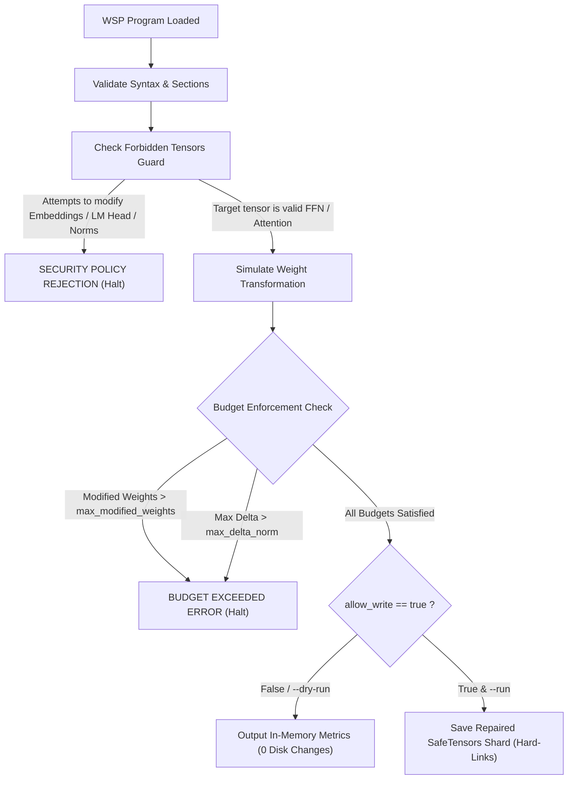

# WSP-Lang 0.2: Language Specification & Runtime Architecture

**Version:** 0.2.0  
**License:** MIT  
**Module:** `engine/wsplang.py`  
**Repository:** [https://github.com/FiveTechSoft/weights](https://github.com/FiveTechSoft/weights)  

---

### Executive Overview

**Weights Space Programming Language (WSP-Lang 0.2)** is a declarative, domain-specific language (DSL) for auditing, decompiling, and surgically modifying neural network weights directly without backpropagation, fine-tuning, or gradient descent.

WSP-Lang 0.2 introduces a major architectural leap over version 0.1:
1. **Dual Engine Support:** Native surgery across both **unquantized SafeTensors (BF16/FP16)** and **quantized GGUF block structures**.
2. **Algebraic Weight Surgery:** Declarative rank-1 low-rank projection operations (`project_out`, `project_in`).
3. **Formal Security & Budget Governance:** Hard boundary enforcement (`max_modified_weights`, `max_delta_norm`, `allow_write`) and forbidden tensor guards.
4. **Automated Control Vector Compilation:** Compiles contrastive residual directions into `llama.cpp` control vector GGUF binaries.
5. **Contract Verification:** In-memory dry runs, tensor health audits (`audit`), and structural diff verification (`diff`).

---

### 1. Structure of a WSP-Lang 0.2 Program

A `.wspl` program is composed of structured declarative blocks:

```wspl
experiment <experiment_name>:

    model:
        <model_identifier>

    format:
        safetensors | gguf

    objective:
        <high_level_goal_description>

    budgets:
        max_modified_weights = <integer>
        target_parameter_fraction = <float>
        max_delta_norm = <float>
        allow_write = true | false

    semantic_areas:
        mode = differential | direct
        target = <semantic_centroid_name>

    preconditions:
        <contract_assertions>

    steps:
        # Step operations executed sequentially
        step audit <tensor> [vector=<path>]
        step project_out <tensor> vector=<path> alpha=<float> [top_cols=<float>] [top_rows=<int>]
        step export_control_vector <vector_path> out=<path> [scale=<float>]

    postconditions:
        <contract_assertions>
```

---

### 2. Operational Semantics & Step Reference

#### 2.1. `project_out` (Subtractive Directional Projection)
Subtracts a rank-1 projection along a target direction vector $u$ from the specified weight tensor:

$$W_{:, \text{cols}} \leftarrow W_{:, \text{cols}} - \alpha \cdot u (u^T W_{:, \text{cols}})$$

- **Arguments:**
  - `tensor`: Target weight matrix (e.g., `model.language_model.layers.14.mlp.down_proj.weight`).
  - `vector`: Path to normalized NumPy `.npz` or `.npy` direction vector.
  - `alpha`: Subtractive scaling factor (default: `0.05`).
  - `top_cols`: Fraction of most energetic intermediate columns to modify (default: `0.127`).
  - `top_rows`: Maximum coordinate rows of $u$ to alter (default: `50`).
- **Safety:** Aborts immediately if number of altered weights exceeds `max_modified_weights` or max delta exceeds `max_delta_norm`.

#### 2.2. `project_in` (Additive Directional Reinforcement)
Reinforces a target concept or capability direction along $u$:

$$W_{:, \text{cols}} \leftarrow W_{:, \text{cols}} + \alpha \cdot u (u^T W_{:, \text{cols}})$$

#### 2.3. `audit` (Tensor Energy & Norm Verification)
Computes real-time spectral and directional metrics on a weight matrix:
- Frobenius norm: $\|W\|_F$
- Peak magnitude: $\|W\|_\infty$
- Directional energy along vector: $\|u^T W\|_2$

#### 2.4. `export_control_vector` (llama.cpp GGUF Control Vector)
Compiles a direction vector into a standard `llama.cpp` control vector GGUF binary for zero-disk-mutation runtime inference steering (`--control-vector-scaled`).

#### 2.5. Legacy Operations (WSP-Lang 0.1 Fully Supported)
- `step peek <tensor> [row=<int>] [col=<int>] [k=<int>]`: Decompile tensor anatomy and semantic centroid projections.
- `step semantic_map [top=<int>]`: Global model semantic centroid map.
- `step diff <tensor> base=<path>`: Structural parameter difference check against base weights.
- `step compare <file.json>`: Benchmark evaluation delta comparison.

---

### 3. Security & Budget Governance

To prevent catastrophic forgetting or model corruption, WSP-Lang 0.2 enforces strict safety boundaries:



#### Forbidden Tensors
The following critical routing tensors cannot be altered by WSP programs:
- `token_embd.weight` / `model.embed_tokens.weight`
- `output.weight` / `lm_head.weight`
- `output_norm.weight` / `model.norm.weight`

---

### 4. Command Line Interface (CLI)

```bash
# 1. Syntax, budget, and security check (instant):
python engine/wsplang.py programs/mimo_surgical_safetensors_v2.wspl --check

# 2. Output structured JSON execution plan:
python engine/wsplang.py programs/mimo_surgical_safetensors_v2.wspl --plan

# 3. Simulate execution in-memory without modifying disk (Dry Run):
python engine/wsplang.py programs/mimo_surgical_safetensors_v2.wspl --dry-run

# 4. Execute program and write repaired model:
python engine/wsplang.py programs/mimo_surgical_safetensors_v2.wspl --run \
  --model /path/to/source_model \
  --out /path/to/repaired_model
```

---

### 5. Verification Manifests

Every run automatically generates a verifiable cryptographic and execution manifest in `challenges/wsplang/<experiment_name>.manifest.json`:
- Timestamp and engine version (`0.2.0`).
- Exact modified parameter counts and percentages.
- Directional energy reduction before and after surgery.
- Security verification status (`validated: true`).
