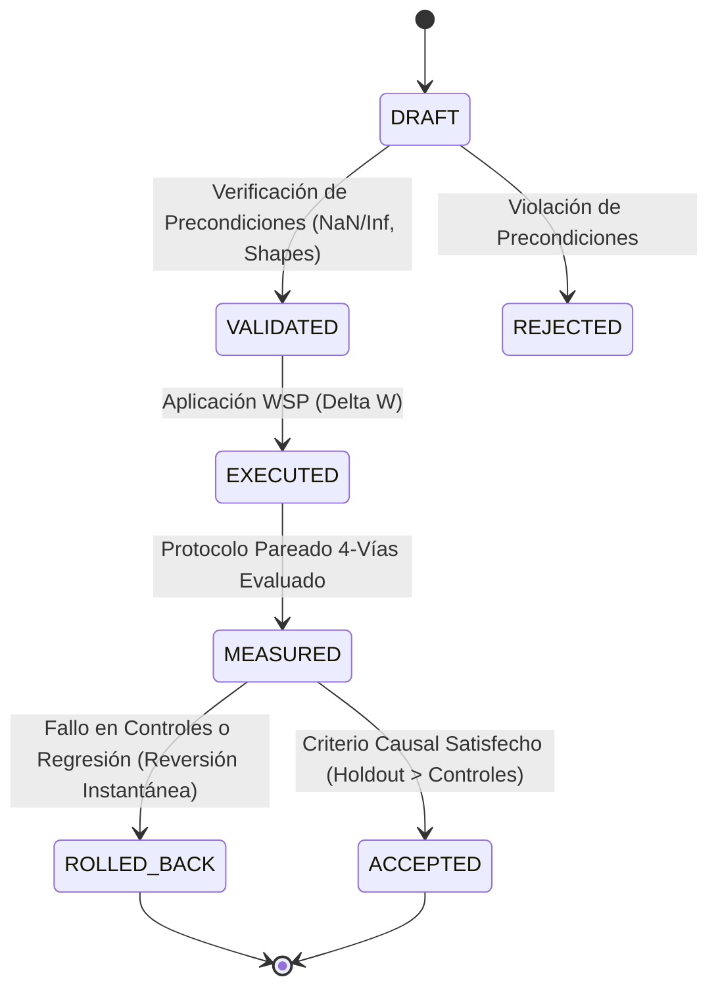
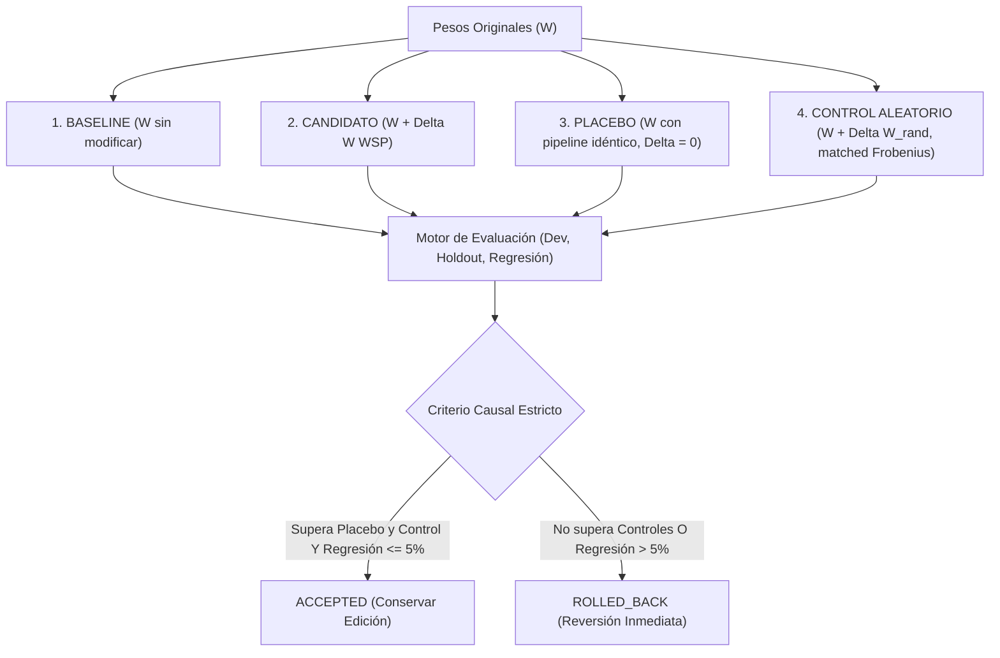

# Especificación Técnica WSP-Lang 0.7.0

**Versión:** 0.7.0  
**Fecha:** 4 de Noviembre de 2026  
**Estado:** Activo y Verificado Empíricamente  
**Licencia:** MIT  

---

## 1. Resumen Ejecutivo y Cambio de Paradigma

WSP-Lang 0.7 marca la transición de Weight-Space Programming de un **lenguaje de manipulación algebraica de pesos** a un **entorno formal de experimentación y verificación causal bajo contratos**.

En versiones previas (0.1 a 0.6), WSP-Lang introdujo operadores matemáticos rigurosos:
- **0.2 - 0.3:** Cirugía rank-1, Delta-Rule unlearning y Fast Weight Programming.
- **0.4:** Teoría de perturbaciones espectrales (Weyl, Davis-Kahan) y apalancamiento espectral.
- **0.5:** LEACE (borrado de subespacios afines) y regularización de covarianza MEMIT.
- **0.6:** Alineamiento Procrustes para transferencia inter-modelo (MiMo $\to$ TinyLlama).

Sin embargo, una propiedad algebraica demostrable (por ejemplo, anular una proyección $u^T W = 0$) **no equivale a demostrar una mejora conductual en generación libre**. WSP-Lang 0.7 resuelve esta brecha transformando cada intervención en un **contrato causal con ejecución pareada de 4 vías y rollback automático obligatorio**.

---

## 2. El Contrato de Intervención (`InterventionContract`)

Toda intervención en WSP-Lang 0.7 debe formalizarse como una instancia inmutable de un contrato antes de modificar cualquier tensor:

```python
@dataclass
class InterventionContract:
    target_model_name: str
    target_tensor_name: str
    hypothesis: str
    expected_behavior: str
    evaluation_suite: EvaluationSuite
    allowed_weight_fraction: float = 0.05       # Perturbación Frobenius máxima relativa (5%)
    max_delta_norm: float = 5.0                # Cota superior absoluta en ||Delta W||_F
    max_regression_tolerance_pct: float = 5.0   # Tolerancia máxima de pérdida en regresión
    min_holdout_improvement_pct: float = 15.0  # Ganancia mínima exigida sobre controles
    rollback_on_failure: bool = True           # Reversión garantizada si no supera controles
    metadata: Dict[str, Any] = field(default_factory=dict)
```

---

## 3. Máquina de Estados del Ciclo de Vida

El ciclo de vida de un contrato se modela formalmente como una máquina de estados determinista:



### Definición de Estados:
- **`DRAFT`:** Definición de hipótesis, particiones de evaluación y cotas.
- **`VALIDATED`:** Precondiciones matemáticas superadas (ausencia de valores atípicos, dimensiones compatibles).
- **`EXECUTED`:** Cálculo e inyección de $\Delta W$ en el tensor objetivo.
- **`MEASURED`:** Métricas completadas sobre las 4 ramas del protocolo.
- **`ACCEPTED`:** Superación demostrable de la línea base, placebo y control aleatorio sin regresión.
- **`ROLLED_BACK`:** Reversión atómica inmediata al tensor original baseline.

---

## 4. El Protocolo Pareado de 4 Vías

Para descartar mejoras espurias, artefactos de pipeline o perturbaciones aleatorias favorables, el motor ejecuta cuatro condiciones paralelas idénticas:



### Las Cuatro Ramas:
1. **Línea Base ($W$):** Comportamiento no intervenido.
2. **Candidato ($W + \Delta W$):** Intervención WSP propuesta.
3. **Placebo:** Ejecución que atraviesa la misma ruta de cómputo con $\Delta W = 0$.
4. **Control Aleatorio Ortogonal ($W + \Delta W_{\text{rand}}$):** Matriz aleatoria con norma de Frobenius exactamente equiparada:
   $$\|\Delta W_{\text{rand}}\|_F = \|\Delta W\|_F$$

---

## 5. Criterio Formal de Aceptación Causal

Una intervención **sólo** se promueve a `ACCEPTED` si cumple simultáneamente:

$$\text{Aceptación} \iff \begin{cases} 
\text{Acc}_{\text{cand}}(\text{Holdout}) - \text{Acc}_{\text{base}}(\text{Holdout}) \ge \tau_{\text{min}} \\
\text{Acc}_{\text{cand}}(\text{Holdout}) > \text{Acc}_{\text{placebo}}(\text{Holdout}) \\
\text{Acc}_{\text{cand}}(\text{Holdout}) > \text{Acc}_{\text{random}}(\text{Holdout}) \\
\text{Pérdida}_{\text{regr}}(\text{Regression}) \le \epsilon_{\text{tol}} \\
\frac{\|\Delta W\|_F}{\|W\|_F} \le \delta_{\text{max}}
\end{cases}$$

Si cualquiera de estas desigualdades no se cumple, el sistema ejecuta un **Rollback Automático**:
$$W \leftarrow W_{\text{orig}}$$

---

## 6. Separación Arquitectónica: WSP-Lang vs NanoWSP

Para evitar confusiones en el ecosistema, WSP-Lang 0.7 establece formalmente dos líneas de trabajo independientes:

1. **WSP-Lang:** Sistema de lenguaje, verificación causal, contratos y álgebra tensorial para la intervención de LLMs existentes (MiMo, TinyLlama, Qwen, etc.).
2. **NanoWSP:** Arquitectura de micro-LLM nativa construida desde cero ($< 3.5\text{M}$ parámetros) para experimentar con representaciones condensadas y memoria matricial en escala ultra-reducida.

---

## 7. Teorema de Invariancia de Tamaño

Bajo WSP-Lang, todas las cirugías sobre modelos compilados (GGUF o SafeTensors) garantizan la invariancia estricta del tamaño del archivo y el recuento de parámetros:

$$\Delta \text{Bytes} = 0, \quad \Delta \text{Parámetros} = 0$$

Dado que $\Delta W \in \mathbb{R}^{d_{\text{out}} \times d_{\text{in}}}$, la suma $W_{\text{new}} = W_{\text{orig}} + \Delta W$ ocupa exactamente la misma memoria que $W_{\text{orig}}$.
