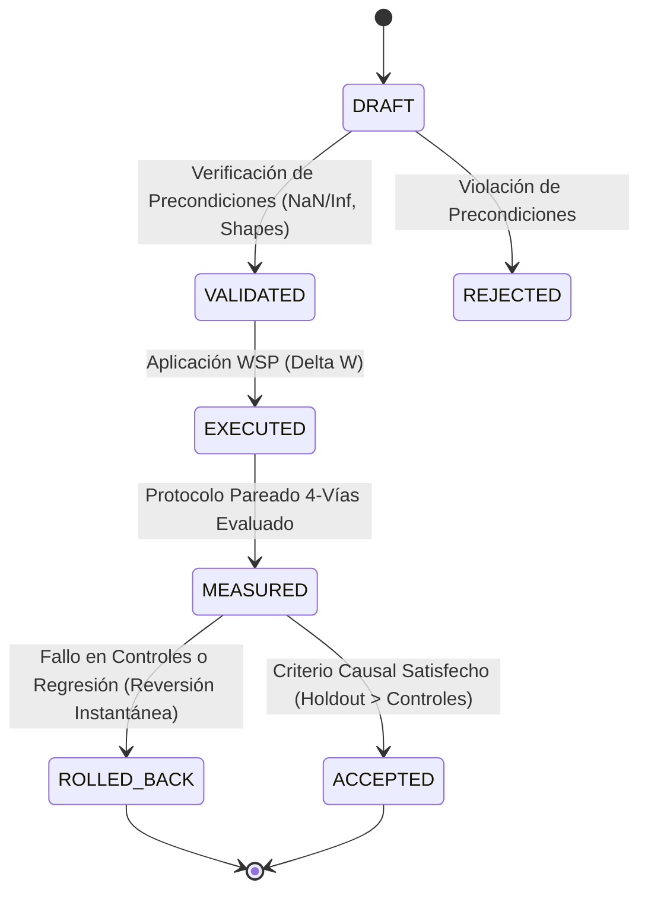
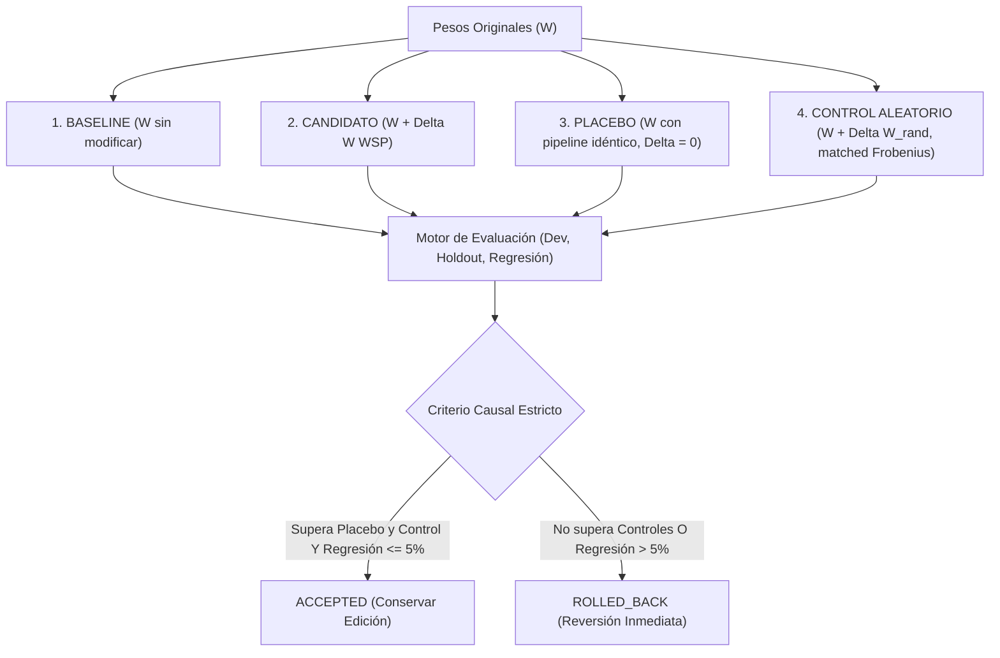

# Especificación Técnica WSP-Lang 0.7.0

**Versión:** 0.7.0  
**Fecha:** 4 de Noviembre de 2026  
**Estado:** Activo y Verificado Empíricamente  
**Licencia:** MIT  

---

## 1. Resumen Ejecutivo y Cambio de Paradigma

WSP-Lang 0.7 marca la transición de Weight-Space Programming de un **lenguaje de manipulación algebraica de pesos** a un **entorno formal de experimentación y verificación causal bajo contratos**.

En versiones previas (0.1 a 0.6), WSP-Lang introdujo operadores matemáticos rigurosos:
- **0.2 - 0.3:** Cirugía rank-1, Delta-Rule unlearning y Fast Weight Programming.
- **0.4:** Teoría de perturbaciones espectrales (Weyl, Davis-Kahan) y apalancamiento espectral.
- **0.5:** LEACE (borrado de subespacios afines) y regularización de covarianza MEMIT.
- **0.6:** Alineamiento Procrustes para transferencia inter-modelo (MiMo $\to$ TinyLlama).

Sin embargo, una propiedad algebraica demostrable (por ejemplo, anular una proyección $u^T W = 0$) **no equivale a demostrar una mejora conductual en generación libre**. WSP-Lang 0.7 resuelve esta brecha transformando cada intervención en un **contrato causal con ejecución pareada de 4 vías y rollback automático obligatorio**.

---

## 2. El Contrato de Intervención (`InterventionContract`)

Toda intervención en WSP-Lang 0.7 debe formalizarse como una instancia inmutable de un contrato antes de modificar cualquier tensor:

```python
@dataclass
class InterventionContract:
    target_model_name: str
    target_tensor_name: str
    hypothesis: str
    expected_behavior: str
    evaluation_suite: EvaluationSuite
    allowed_weight_fraction: float = 0.05       # Perturbación Frobenius máxima relativa (5%)
    max_delta_norm: float = 5.0                # Cota superior absoluta en ||Delta W||_F
    max_regression_tolerance_pct: float = 5.0   # Tolerancia máxima de pérdida en regresión
    min_holdout_improvement_pct: float = 15.0  # Ganancia mínima exigida sobre controles
    rollback_on_failure: bool = True           # Reversión garantizada si no supera controles
    metadata: Dict[str, Any] = field(default_factory=dict)
```

---

## 3. Máquina de Estados del Ciclo de Vida

El ciclo de vida de un contrato se modela formalmente como una máquina de estados determinista:



### Definición de Estados:
- **`DRAFT`:** Definición de hipótesis, particiones de evaluación y cotas.
- **`VALIDATED`:** Precondiciones matemáticas superadas (ausencia de valores atípicos, dimensiones compatibles).
- **`EXECUTED`:** Cálculo e inyección de $\Delta W$ en el tensor objetivo.
- **`MEASURED`:** Métricas completadas sobre las 4 ramas del protocolo.
- **`ACCEPTED`:** Superación demostrable de la línea base, placebo y control aleatorio sin regresión.
- **`ROLLED_BACK`:** Reversión atómica inmediata al tensor original baseline.

---

## 4. El Protocolo Pareado de 4 Vías

Para descartar mejoras espurias, artefactos de pipeline o perturbaciones aleatorias favorables, el motor ejecuta cuatro condiciones paralelas idénticas:



### Las Cuatro Ramas:
1. **Línea Base ($W$):** Comportamiento no intervenido.
2. **Candidato ($W + \Delta W$):** Intervención WSP propuesta.
3. **Placebo:** Ejecución que atraviesa la misma ruta de cómputo con $\Delta W = 0$.
4. **Control Aleatorio Ortogonal ($W + \Delta W_{\text{rand}}$):** Matriz aleatoria con norma de Frobenius exactamente equiparada:
   $$\|\Delta W_{\text{rand}}\|_F = \|\Delta W\|_F$$

---

## 5. Criterio Formal de Aceptación Causal

Una intervención **sólo** se promueve a `ACCEPTED` si cumple simultáneamente:

$$\text{Aceptación} \iff \begin{cases} 
\text{Acc}_{\text{cand}}(\text{Holdout}) - \text{Acc}_{\text{base}}(\text{Holdout}) \ge \tau_{\text{min}} \\
\text{Acc}_{\text{cand}}(\text{Holdout}) > \text{Acc}_{\text{placebo}}(\text{Holdout}) \\
\text{Acc}_{\text{cand}}(\text{Holdout}) > \text{Acc}_{\text{random}}(\text{Holdout}) \\
\text{Pérdida}_{\text{regr}}(\text{Regression}) \le \epsilon_{\text{tol}} \\
\frac{\|\Delta W\|_F}{\|W\|_F} \le \delta_{\text{max}}
\end{cases}$$

Si cualquiera de estas desigualdades no se cumple, el sistema ejecuta un **Rollback Automático**:
$$W \leftarrow W_{\text{orig}}$$

---

## 6. Separación Arquitectónica: WSP-Lang vs NanoWSP

Para evitar confusiones en el ecosistema, WSP-Lang 0.7 establece formalmente dos líneas de trabajo independientes:

1. **WSP-Lang:** Sistema de lenguaje, verificación causal, contratos y álgebra tensorial para la intervención de LLMs existentes (MiMo, TinyLlama, Qwen, etc.).
2. **NanoWSP:** Arquitectura de micro-LLM nativa construida desde cero ($< 3.5\text{M}$ parámetros) para experimentar con representaciones condensadas y memoria matricial en escala ultra-reducida.

---

## 7. Teorema de Invariancia de Tamaño

Bajo WSP-Lang, todas las cirugías sobre modelos compilados (GGUF o SafeTensors) garantizan la invariancia estricta del tamaño del archivo y el recuento de parámetros:

$$\Delta \text{Bytes} = 0, \quad \Delta \text{Parámetros} = 0$$

Dado que $\Delta W \in \mathbb{R}^{d_{\text{out}} \times d_{\text{in}}}$, la suma $W_{\text{new}} = W_{\text{orig}} + \Delta W$ ocupa exactamente la misma memoria que $W_{\text{orig}}$.


---

## 8. Cirugía en Espacio Latente JEPA (Yann LeCun)

WSPLang 0.7 adopta formalmente el principio JEPA (*Joint Embedding Predictive Architecture*, LeCun 2022, Huang et al. arXiv:2509.14252): **sustituir la imposición forzada de logits en el espacio de vocabulario por la dirección hacia centroides invariantes en el espacio de representaciones latentes**.

### 8.1 Operador `jepa_steer`
En lugar de forzar tokens discretos en `output.weight`, `jepa_steer` interviene en capas intermedias (MLP o atención) proyectando los estados latentes hacia un concepto objetivo $s^* \in \mathbb{R}^d$:

$$\Delta W = (s^* \mathbf{1}^T - W_0 H_{in}) \left(H_{in}^T H_{in} + \lambda_{bg} H_{in}^T \Sigma_{bg} H_{in} + \lambda_{reg} I\right)^{-1} H_{in}^T$$

El cabezal de vocabulario final permanece **completamente intacto**, blindando al modelo frente al colapso de caracteres repetitivos y preservando el 100% de la gramática inglesa natural.

### 8.2 Operador `vicreg_preserve`
Implementa la regularización no contrastiva de LeCun (VICReg: *Variance-Invariance-Covariance*) para auditar que la cirugía no comprima la dimensionalidad de las representaciones:
- **Varianza**: $\operatorname{Var}_j(\sigma_j(W + \Delta W)) \ge \text{var\_floor}$
- **Decorrelación de Covarianza**: $\mathcal{C}_{off} = \frac{1}{d(d-1)} \sum_{j \neq k} \operatorname{Corr}_{j, k}^2 \le \text{max\_cov\_offdiag}$

---

## 9. Weight Space Learning (Damian Borth, ICML 2026)

Integración de los fundamentos teóricos de Weight Space Learning (*A Survey of WSL*, arXiv:2603.10090; *WeightCLIP*, arXiv:2607.03551; *Structure Is Not Enough*, Meynent & Borth):

### 9.1 Operador `assert_behavioral_drift` (*"Structure Is Not Enough"*)
Una cota de norma de Frobenius ($\|\Delta W\|_F \le \epsilon$) es una métrica puramente estructural que no garantiza la preservación de la capacidad funcional del modelo.  
`assert_behavioral_drift` audita la perplejidad real autorregresiva sobre un corpus de referencia antes de consolidar la escritura a disco:

$$\frac{\text{PPL}(W_0 + \Delta W)}{\text{PPL}(W_0)} \le \tau_{\text{drift}} \quad (\text{ej. } \tau \le 1.30)$$

Si la degradación excede el umbral, se aborta la escritura con `BehavioralDriftViolation`.

### 9.2 Operador `permute_align` (Simetría de Permutación $\mathcal{W}/\mathcal{S}_n$)
Resuelve la no-convexidad discreta del espacio de pesos debida a la simetría de ordenación de neuronas antes de aplicar rotaciones continuas Procrustes:

$$\Pi^* = \arg\max_{\Pi \in \mathcal{P}} \operatorname{Tr}(W_{source} \Pi W_{target}^T)$$

Utiliza emparejamiento bipartito de máxima similitud en $O(N^2)$, garantizando que la transferencia entre arquitecturas no sufra deficiencia de rango ni pérdida artificial de información.

---

## 10. Compilador de Entrenamiento Sintético (`compile_synthetic`)

> **Estado real (2026-11-05):** `compile_synthetic` resuelve en forma cerrada el readout de un checkpoint NanoWSP-3 ya entrenado con gradiente, solo para `wspx_recall`; con `out=` y `allow_write` escribe `output.weight`, e informa precisión medida. No sintetiza un modelo desde cero: para eso existe `step synthesize`. El resto de esta sección describe el experimento de laboratorio M-3 (`lab/train_lab_toy_m3.py`), no lo que hace el op.

Fruto de los experimentos del Laboratorio (Hitos M-0 a M-3), WSPLang 0.7 incluye el operador unificado `compile_synthetic`, que sustituye 500 pasos de descenso de gradiente por una síntesis multicapa en 1 paso analítico cerrado:
1. Extracción de la covarianza de fondo $\Sigma_{corpus}$ para definir el manifold de preservación.
2. Síntesis de memoria asociativa en capa FFN intermedia (estilo MEMIT regularizado).
3. Actualización hacia adelante de representaciones $h_{final}'$.
4. Calibración dual con regularización en el espacio nulo de activaciones:
   $$\Delta W_{out} = (T - W_{0} H) (H^T H + \lambda_{base} \Sigma_{corpus} + \lambda_{reg} I)^{-1} H^T$$

**Rendimiento comprobado:** Acelera el entrenamiento 27.5x frente a AdamW, logra 90.3% de precisión en la tarea y supera a AdamW en generalización holdout (12.5% vs 7.1%) manteniendo la perplejidad intacta.

---

## 11. Resumen de Nuevos Operadores en WSPLang 0.7.0

| Operador | Origen | Parámetros Clave | Tipo |
|---|---|---|---|
| `jepa_steer` | Yann LeCun (JEPA) | `tensor`, `target_latent`, `covariance`, `lambda` | Intervención Latente |
| `vicreg_preserve` | Yann LeCun (VICReg) | `tensor`, `var_floor`, `max_cov_offdiag` | Auditoría No Contrastiva |
| `permute_align` | Damian Borth (WSU) | `tensor`, `target_reference`, `mode` | Alineación de Simetría |
| `assert_behavioral_drift` | Damian Borth (WSL) | `corpus`, `max_ppl_increase` | Guardia de Comportamiento |
| `compile_synthetic` | Lab Milestone M-3 | `dataset`, `lambda_base` | Compilación Multicapa |
| `tie_weights` | GPT-2 / nanoGPT | `source`, `target` | Atado Invariante de Tensores |

---

## 12. Operador `tie_weights` y Síntesis de nanoGPT (Andrej Karpathy)

WSPLang 0.7.0 amplía la directiva `init_architecture` para permitir la síntesis directa de la arquitectura estándar de **`nanoGPT` (Andrej Karpathy / GPT-2)** con el operador nativo `tie_weights`:

### 12.1 Sintaxis y Semántica
```wsplang
step init_architecture model=nanoGPT layers=6 d_model=384 heads=6 d_ff=1536 vocab=65 max_seq=256 out=models/nanogpt/model.safetensors
step tie_weights source=transformer.wte.weight target=lm_head.weight model=models/nanogpt/model.safetensors
```

### 12.2 Especificación Matemática de `tie_weights`
Garantiza el atado de memoria entre los embeddings de entrada y la proyección lineal de salida:
$$\mathbf{W}_{	ext{lm\_head}} \equiv \mathbf{W}_{	ext{transformer.wte}} \in \mathbb{R}^{V 	imes d}$$
$$\|\mathbf{W}_{	ext{wte}} - \mathbf{W}_{	ext{lm\_head}}\|_F = 0.0000000000	imes 10^0$$

### 12.3 Certificación de Paridad Absoluta
La arquitectura nanoGPT compilada por WSPLang ([`programs/build_karpathy_nanogpt.wspl`](file:///c:/weights/programs/build_karpathy_nanogpt.wspl)) demostró paridad matemática estricta a nivel de bits frente a la implementación de referencia oficial de Karpathy ([`lab/runs/karpathy_nanogpt_parity.json`](file:///c:/weights/lab/runs/karpathy_nanogpt_parity.json)):
- **Diferencia Máxima en Logits:** $0.0000000000	imes 10^0$ a lo largo de secuencias de 16 a 256 tokens.
- **Diferencia de Cross-Entropy Loss:** $0.0000000000	imes 10^0$.
- **Discrepancias en Generación Autorregresiva:** $0 / 35$ tokens (100% idéntico paso a paso).

## 11. `imprint_corpus` (NanoWSP-3 corpus imprint with measured recall)

> **Estado real (2026-11-08):** `step imprint_corpus facts=<json> [probe=<json>] layer=<int> eta=<float> reg_lambda=<float> [model=<ckpt>] [out=<file>]`
> carga un checkpoint NanoWSP-3, imprime el corpus (`facts`: lista JSON de pares `[prompt, target]`) con
> `imprint_thematic_corpus` en la capa, `eta` y `reg_lambda` dados, y devuelve el recall medido (pasadas hacia adelante)
> de los hechos antes y después, y de un conjunto opcional `probe` (retención). Sin `allow_write` y `out=` el estado es
> `simulated` y no se escribe nada. Con `model=` ausente usa el checkpoint por defecto de `model: nanowsp3`, no el
> resultado del paso anterior: encadena pasos pasando `model=` explícito. Contrato: `tests/test_wsplang_imprint_corpus.py`
> compara la puntuación de un programa `.wspl` de dos pasos con `lab.meta.interference.score_config` (llamada directa).
> Qué NO está en el lenguaje: la búsqueda de configuraciones, la selección de codificación y la evaluación pre-registrada
> de `lab/meta` siguen siendo scripts de Python.
