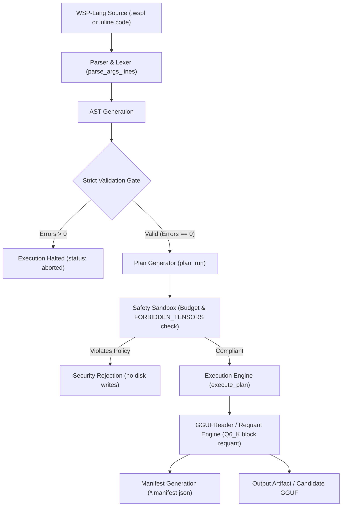
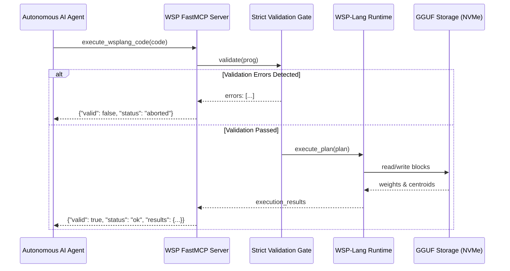

# WSP-Lang 0.1: Declarative Language Specification for Weight-Space Programming

**Version:** 0.1.0  
**Status:** Living Specification  
**Authors:** FiveTechSoft Engineering & Research Team  
**Repository:** [github.com/FiveTechSoft/weights](https://github.com/FiveTechSoft/weights)  
**License:** MIT License  

---

## 1. Executive Summary & Philosophy

**Weight-Space Programming (WSP)** represents a fundamental paradigm shift in how we analyze, steer, and modify Large Language Models (LLMs). Rather than treating neural network weights as an opaque black-box to be modified exclusively via stochastic gradient descent (backpropagation) or expensive fine-tuning pipelines, WSP posits that:

$$\mathcal{W} \in \mathbb{R}^{D_{\text{model}} \times D_{\text{out}}} \quad \text{encodes a structured, decomposable computer program.}$$

**WSP-Lang** is the domain-specific declarative programming language designed to query, decompile, steer, and surgically mutate neural network weights in quantized formats (such as GGUF `Q6_K` and `BF16`) with:
1. **Zero forward passes** required for weight inspection and semantic decompilation.
2. **Deterministic, falsifiable hypothesis definitions** (every program declares its hypothesis, budget, and validation threshold).
3. **Hardware safety & physical barriers** (`FORBIDDEN_TENSORS` and pre-execution validation gates).
4. **Machine-agent interoperability** via native Model Context Protocol (FastMCP) bindings.

---

## 2. System Architecture

The WSP-Lang execution pipeline guarantees that no weights on disk can be modified unless a program passes syntactic validation, semantic constraint checks, and safety budget verification:



---

## 3. Formal Syntax & EBNF Grammar

A WSP-Lang source file (`.wspl`) is organized into structured blocks using clean, Pythonic indentation:

```ebnf
Program         ::= ExperimentHeader Block*
ExperimentHeader::= "experiment" Identifier ":"
Block           ::= MetadataBlock | BudgetBlock | SemanticBlock | StepsBlock | HoldoutBlock

MetadataBlock   ::= "model:" String
                  | "objective:" String
                  | "hypothesis:" String

BudgetBlock     ::= "budgets:" Newline (Indent Key "=" Value)+

SemanticBlock   ::= "semantic_areas:" Newline (Indent Key "=" Value)+

StepsBlock      ::= "steps:" Newline (Indent StepStatement)+
StepStatement   ::= "step" Operation Arguments*

HoldoutBlock    ::= "holdout:" Newline (Indent Key "=" Value)+
```

### Lexical Conventions
- **Comments:** Lines beginning with `#` are comments and are ignored by the parser.
- **Indentation:** 4 spaces (or consistent tabs).
- **Identifiers:** Alphanumeric characters plus underscores and periods (`blk.19.attn_output.weight`).
- **Numbers:** Integers (`100`), floats (`+0.0275`, `1.5e-4`), or ratios (`1/2`).

---

## 4. Program Structure & Sections

### 4.1. Header & Experiment Declaration
Every program begins with a unique experiment identifier:

```wspl
experiment inspect_attention_logic:
    model: MiMo-V2.6-Distill-Qwen-9B
    objective: map_semantic_geometry
    hypothesis: "Layer 19 Attention Head 0 projects into the Math & Logic residual stream"
```

### 4.2. Safety Budgets (`budgets:`)
Defines the strict physical bounds that the execution engine is permitted to touch:

```wspl
budgets:
    max_norm_delta = 0.05
    max_modified_weights = 16384
    allow_write = false
```

### 4.3. Semantic Taxonomy (`semantic_areas:`)
Configures the differential centroid projection engine:

```wspl
semantic_areas:
    mode = differential
    target = math_logic
    contrast = centered
```

### 4.4. Execution Steps (`steps:`)
The sequence of atomic declarative operations executed by the runtime.

---

## 5. Instruction Set Architecture (Primitives)

WSP-Lang 0.1 implements five core operations designed for mechanistic interpretability and surgical intervention:

### 5.1. `step semantic_map`
Queries the model's global semantic taxonomy or calculates the functional projection of a specific tensor.

* **Syntax:**
  ```wspl
  step semantic_map [tensor=<tensor_name>] [top=<k>]
  ```
* **Parameters:**
  * `tensor`: Optional. The target GGUF tensor to project (e.g. `blk.14.ffn_down.weight`). If provided, areas are ranked by actual cosine projection:
    $$\text{score}(T, \mathbf{C}'_a) = \frac{\bar{\mathbf{v}}_T \cdot \mathbf{C}'_a}{\|\bar{\mathbf{v}}_T\| \|\mathbf{C}'_a\|}$$
  * `top`: Number of top-scoring areas to return. If omitted, all 10 areas are returned.
* **Output:** Ranked dictionary with dominant area, scores, and representative affine seeds.

---

### 5.2. `step peek`
Performs surgical, read-only decompilation of a single weight, row, column, or tensor slice.

* **Syntax:**
  ```wspl
  step peek <tensor> [row=<r>] [col=<c>] [top=<k>]
  ```
* **Parameters:**
  * `<tensor>`: Complete GGUF tensor name.
  * `row=<r>`: Target row (residual stream target dimension).
  * `col=<c>`: Target column (input channel / internal head dimension).
  * `top=<k>`: Number of semantic affinities to decompile.
* **Architectural Decompilation:**
  * For attention projections (`attn_output.weight`), `peek` automatically computes the attention head index:
    $$\text{head\_idx} = \left\lfloor \frac{\text{col}}{\text{head\_dim}} \right\rfloor$$
  * For FFN down projections (`ffn_down.weight`), `peek` correlates intermediate activation neurons with the residual target stream.

---

### 5.3. `step poke`
Modifies an individual scalar weight in-place while preserving numerical integrity across the remaining 255 values in the `Q6_K` block.

* **Syntax:**
  ```wspl
  step poke <tensor> <row> <col> <target_value> [out=<output_path>]
  ```
* **Parameters:**
  * `tensor`: Target tensor (strictly validated against `FORBIDDEN_TENSORS`).
  * `row`, `col`: Matrix coordinates.
  * `target_value`: Absolute floating-point target value.
  * `out`: Optional destination file. If omitted, generates a candidate in `served/`.
* **Guarantees:**
  * Zero collateral corruption outside the edited 256-element quantization super-block.
  * Canonical requantization via `quantize_row_q6_k_ref` with L1 reconstruction error $< 6.2 \times 10^{-6}$.

---

### 5.4. `step scale`
Scales specific neuron columns or attention heads uniformly to amplify or suppress behavioral features (Behavioral Steering).

* **Syntax:**
  ```wspl
  step scale <tensor> col=<neuron_idx> factor=<alpha>
  ```
* **Parameters:**
  * `col`: Neuron column index in `ffn_down.weight` or attention projection.
  * `factor`: Multiplier (e.g. `2.5` to amplify, `0.25` to suppress).

---

### 5.5. `step steer`
Applies Covariance-Aligned Steering (Dreaming Technique 16) by adding or subtracting an empirical residual control direction vector $\mathbf{u}$:

* **Syntax:**
  ```wspl
  step steer <tensor> vector=<u_npz_path> dose=<alpha>
  ```

---

### 5.6. Studying improved models (added 2026-11-06)
Ops to learn what a fine-tune changed and to move another model along it. Model arguments are directories or files
of safetensors; multimodal (`model.language_model.*`) and text-only (`model.*`) Qwen3.5 names are lined up. Tensors
are read one at a time (a 9B model never sits in memory twice). Reports and signatures are never weight files and
never land inside an input model.

```wspl
step delta_stats base=<model> model=<model> [tensors=<glob>] [out=<report.json>]
step delta_signature base=<model> model=<model> out=<sig.pt> [k=16] [sketch=4096] [tensors=<glob>]
step delta_compare a=<sig.pt> b=<sig.pt> [factor=3] [out=<report.json>]
step evaluate_benchmark endpoint=<port|URL> name=<label> [gsm8k=100] [math500=50] [max_tokens=8192] [out=<report.json>]
step subspace_transfer tensors=<glob> source=<model> basis=sig:<sig.pt>|shared:<a.pt>,<b.pt>|random k=16 alpha=1.0 [seed=0] out=<dir>
step model_report model=<dir|repo id> [base=<dir|repo id>] [rows=128] [card=true] out=<report.md>
```

* `delta_stats`: per tensor, ||ΔW||/||W||, cosine, changed fraction, spectrum of ΔW (top-1 energy, stable rank),
  moved embedding rows; totals per tensor family and per layer.
* `delta_signature`: per tensor, the top-k singular vectors of ΔW on its smaller side, its alignment with the base
  weight's own top-k subspace, and a count-sketch of ΔW, so pairs can be compared after the weights are deleted.
* `delta_compare`: per tensor type, same-layer subspace overlap against the same type at other layers (structured
  null) and against chance k/d; `H3` true when both ratios are >= `factor`.
* `evaluate_benchmark`: GSM8K / MATH-500 with one fixed protocol (greedy, the model's chat template, the boxed
  answer graded by two independent graders) against a server that is already running (e.g. llama-server).
* `model_report`: how a model differs from its base and what is usable, in under a minute for a 9B model read from
  Hugging Face without downloading it. Reads one block of rows per tensor (16 HTTP ranges in flight), classifies
  the change (`identical`, `directional_ablation` with layer range and global or per-layer directions, `lora_like`
  with modules and rank, `full_fine_tune`), shows the card's declared base, license and method words (not trusted),
  the closest studied models of the delta atlas, and what can be reused and how. `base` defaults to the card's
  base_model. Validated on 6 models whose change is known (lab/runs/model_report/validation.json).
* `subspace_transfer`: W' = W + α · P_S(W_source − W_base), the projection on the smaller side. Writes a complete
  model to `out=` (unchanged shards copied, configs copied); every changed shard goes through the write guard with a
  total budget; protected tensors need `unlock_tensors`; on failure the partial output is removed. Provenance
  `synthetic_transfer`, with the source, basis, k and α, is stored in each shard: the op runs no gradient, but the
  update it moves along came from a trained model.

---

## 6. Security Model & Runtime Guardrails

WSP-Lang enforces a multi-layer defense-in-depth model to prevent accidental model corruption:

### 6.1. The Protected Tensor Policy (`FORBIDDEN_TENSORS`)
Under no circumstances may a WSP-Lang program write to or mutate critical grounding tensors:
* `token_embd.weight`: Token embedding matrix.
* `output.weight`: Unembedding / language model head.
* `output_norm.weight`: Final layer normalization.
* `*.norm`, `*.attn_norm.weight`, `*.ffn_norm.weight`: Internal RMSNorm scales.

Any step attempting a `poke` or `scale` on a protected tensor is immediately blocked with:
```json
{
  "status": "security_rejection",
  "error": "SECURITY POLICY REJECTION: Tensor 'output.weight' is protected from direct edit."
}
```

### 6.1b. Write guard (enforced since 2026-11-05)
Every op that writes weights goes through one check, `guard_model_write` in `engine/wsplang.py`
(tests: `tests/test_wsp_write_guard.py`). Before this, only `project_out`, `project_in` and `delta_unlearn`
applied budgets and protected tensors, and several ops overwrote the model they read
(`lab/audit/README.md`).
* An edit never overwrites the model it read. It writes to `out=<file>` or `--out-dir`; without either it
  is an error. A file written earlier by the same run may be edited in place.
* The edited file keeps the source's tensor names, shapes and dtypes. Added, dropped or reshaped tensors
  are refused.
* Changed elements must be `<= max_modified_weights`, and max |delta| must be `<= max_delta_norm`. Both are
  measured on the file about to be written. Simulations (`allow_write = false`) run the same check.
* Protected tensors (the list above, plus names containing `embed`, `lm_head`, `wte`, `ln_f`, `norm.weight`)
  change only when the program lists them: `unlock_tensors = lm_head.weight, output.weight` under `budgets:`.
* `export_control_vector` writes only with `allow_write = true`.
* A failed assertion gets status `assertion_failed`. The CLI exits with code 1 when any step has status
  `error`, `security_rejection` or `assertion_failed`.

### 6.2. Strict Validation Gate
The runtime validates all AST nodes before passing the plan to the execution engine. If `errors > 0`:
1. Disk access is blocked.
2. Model file locks are released.
3. Execution halts with status `aborted`.

---

## 7. Model Context Protocol (FastMCP) Integration

WSP-Lang is natively integrated with FastMCP (`engine/wsp_mcp_server.py`), allowing autonomous agents to execute code without writing to disk:



### Exposed MCP Tools
1. `execute_wsplang_code(code, gguf)`: In-memory declarative execution.
2. `run_wsplang(program_path, execute, gguf)`: File-based declarative execution.
3. `peek_weight(gguf, tensor, row, col, top)`: Read-only anatomical inspection.
4. `poke_weight(gguf, tensor, row, col, value, out)`: Safe surgical weight modification.
5. `get_semantic_areas(gguf, tensor, row, col)`: Centroid map and projection.
6. `run_agent_loop_probe(endpoint, alias, n, ...)`: Agentic tool-call loop benchmarking.
7. `run_logic_probe(endpoint, n, seed)`: Deterministic synthetic Horn-logic verification.

---

## 8. Canonical Program Examples

### Example 1: Multi-Layer Semantic Inspection ([`example_semantic_areas.wspl`](../programs/example_semantic_areas.wspl))
```wspl
experiment inspect_semantic_areas:
    model: MiMo-V2.6-Distill-Qwen-9B
    objective: map_semantic_geometry

    semantic_areas:
        mode = comprehensive
        target = math_logic

    steps:
        # 1. Map top semantic areas
        step semantic_map top=3

        # 2. Inspect Attention Layer 19 (Row 100, Col 200)
        step peek blk.19.attn_output.weight row=100 col=200 top=3

        # 3. Inspect FFN Layer 19 (Row 100, Col 500)
        step peek blk.19.ffn_down.weight row=100 col=500 top=3

        # 4. Inspect Recurrent SSM Layer 0
        step peek blk.0.ssm_out.weight row=100 col=200 top=3
```

---

### Example 2: Weight Synthesis from Scratch ([`blog_exp5_write_mlp.wspl`](../programs/blog_exp5_write_mlp.wspl))
Replicates MIT Blog Experiment 5, synthesizing an exact identity function $f(u) = u$ using twin ReLU activations without training:

$$\text{ReLU}(u) - \text{ReLU}(-u) \equiv u, \quad \forall u \in \mathbb{R}$$

```wspl
experiment write_linear_mlp_from_scratch:
    model: toy_linear_mlp
    objective: synthesize_identity_without_training

    budgets:
        max_parameters = 16
        allow_training = false

    steps:
        # Synthesize up projection weights: [+1, -1]
        step poke blk.0.ffn_up.weight 0 0 1.0
        step poke blk.0.ffn_up.weight 1 0 -1.0

        # Synthesize down projection weights: [+1, -1]
        step poke blk.0.ffn_down.weight 0 0 1.0
        step poke blk.0.ffn_down.weight 0 1 -1.0

        # Verify exact numerical reconstruction across 100 test vectors
        step verify_accuracy dataset=toy_synthetic threshold=1e-7
```

---

### Example 3: Covariance-Aligned Behavioral Steering ([`dreaming_covariance_steering.wspl`](../programs/dreaming_covariance_steering.wspl))
Implements Dreaming Technique 16, amplifying host-defensive or villany neurons in Layer 14 while dampening empathetic compliance:

```wspl
experiment dreaming_covariance_steering:
    model: MiMo-V2.6-Distill-Qwen-9B
    objective: amplify_villain_perspective

    budgets:
        max_modified_weights = 16384
        allow_write = true

    steps:
        # 1. Introspect hostility neuron 4258 in Layer 14
        step peek blk.14.ffn_down.weight col=4258 top=3

        # 2. Scale hostile activation directions
        step scale blk.14.ffn_down.weight col=4258 factor=2.5
        step scale blk.14.ffn_down.weight col=7714 factor=2.0

        # 3. Suppress empathetic compliance neuron
        step scale blk.14.ffn_down.weight col=10739 factor=0.25
```

---

## 9. Manifest & Fingerprint Schema

Execution of any WSP-Lang program automatically generates a cryptographically fingerprinted JSON manifest stored in `challenges/wsplang/<experiment_id>.manifest.json`:

```json
{
  "programa": "inspect_semantic_areas",
  "archivo": "programs/example_semantic_areas.wspl",
  "steps_count": 4,
  "steps": [
    {"sec": "steps", "cmd": "step", "op": "semantic_map", "args": "top=3"},
    {"sec": "steps", "cmd": "step", "op": "peek", "args": "blk.19.attn_output.weight row=100 col=200 top=3"}
  ],
  "plan": {
    "secciones": {"semantic_areas": 2, "steps": 4},
    "ops": {"mode": "comprehensive", "target": "math_logic"}
  },
  "errors": [],
  "validated": true,
  "ts": "2026-11-03T21:30:50",
  "ejecucion": [
    {
      "op": "peek",
      "args": "blk.19.attn_output.weight row=100 col=200 top=3",
      "status": "ok",
      "result": {
        "tensor": "blk.19.attn_output.weight",
        "semantic_areas": {
          "dominant": {"area": "math_logic", "label": "Math & Logic", "score": 0.0275},
          "top_areas": [
            {"area": "math_logic", "label": "Math & Logic", "score": 0.0275},
            {"area": "time_sequence", "label": "Time & Sequence", "score": 0.0149},
            {"area": "social_power", "label": "Social & Power", "score": 0.0098}
          ]
        }
      }
    }
  ]
}
```

---

## 10. Summary & Roadmap

WSP-Lang 0.1 establishes a rigorous, typed, and falsifiable foundation for weight-space programming. Current frozen priorities:
1. **Freeze Core Syntax:** No syntax expansion until the first verified empirical `keep` is established.
2. **Deterministic Evaluation First:** All weight modifications must be gated by `agent_loop_probe` or sealed holdout benchmarks.
3. **Pure BF16 Pipeline:** Transition high-precision experiments to uncompressed BF16 tensors, utilizing canonical `llama-quantize` for final GGUF compilation.
